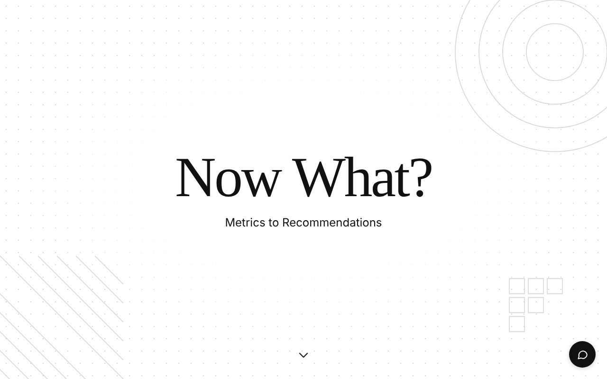
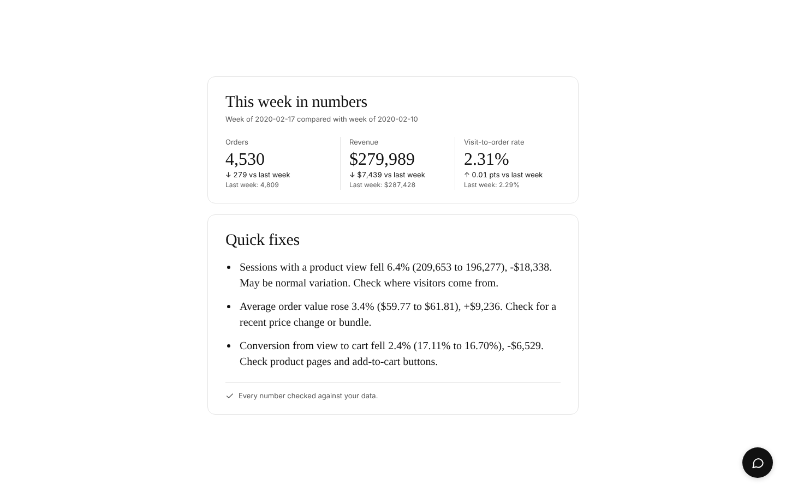

# Now What? Metrics to Recommendations

A product case study in turning merchant analytics into a short list of next steps.

Live demo: https://now-what-zy8f.onrender.com (hosted on a free tier, so the first visit after a quiet period can take up to a minute to load)




## 1. Summary

Online merchants have access to more data than they can act on. Now What? is a working prototype of a decision layer that sits on top of existing store metrics. It compares a store's most recent complete week with the week before, identifies which changes are large enough to matter, estimates their dollar impact, and presents three short recommendations a merchant can read in seconds. A chat assistant answers follow-up questions and states plainly when the data cannot support an answer.

The central design principle is trust and simplicity in that every recommendation presented is verified and optimized for reduced cognitive overload.

## 2. Motivation

The idea came from a Shopify merchant forum discussion about merchant pain points.  A poster explained that merchants know their traffic, conversion rate, product views, abandoned checkouts, returning customers, and revenue. The most difficult part, in the poster's words, was reducing all of that information to a single useful next step without complicating the workflow.

This points to a gap that dashboards do not close of actually telling a time-constrained merchant what to focus on, leading to my product question: Can a tool condense one week of store metrics and tell a merchant what changed, what it cost, and where to look?

My target audience is small and mid-sized merchants without a dedicated analyst, who check their numbers regularly but lack the time or training to interpret week-over-week movement. I would like to present them with a short, prioritized list of next steps.

## 3. Recommendation Process

The system is split into two parts: code that transforms event history data into aggregated results and a language model that explains them. The model is never asked to calculate or discover anything.

Step 1) Raw session events are converted into a weekly funnel (product view, add to cart, purchase). Only complete weeks are compared, so a partial week cannot appear as a decline.

Step 2) The change in orders is separated into a traffic effect (more or fewer visitors) and a conversion effect (visitors buying more or less often). This prevents the most common misdiagnosis: treating a drop in visitors as a problem with the store.

Step 3) Each candidate finding, traffic, each funnel step, average order value, receives an estimated revenue impact and, where applicable, a significance test. A finding is surfaced only if it moves at least 1% of the prior week's revenue and is not statistically unreliable. If nothing qualifies, "nothing needs fixing this week" is a valid result.

Step 4) For each surfaced finding, the system identifies which brands and price bands contributed most.

Step 5) The ranked findings are written into a plain-text fact sheet. Using a language model, Gemini, the fact sheet is condensed into three short bullets, each stating what changed, its dollar value, and one thing to check.

Step 6) Code checks every number in the model's reply against the fact sheet. An unsupported number causes the reply to be rejected and retried once. If it fails again, the application falls back to bullets written directly by code.

For example, using the demo data for the week of 2020-02-17 compared with the week of 2020-02-10, orders fell from 4,809 to 4,530 (down 279), revenue fell from $287,428 to $279,989 (down $7,439), and the visit-to-order rate moved from 2.29% to 2.31%. A dashboard shows "orders down." The decomposition shows that roughly 307 fewer orders came from reduced traffic (sessions with a product view fell 6.4%), while changes in buying behavior added roughly 28. The recommendation therefore directs the merchant to where visitors come from rather than to product pages.

## 4. Architecture

Data flows through four stages, each in its own file.

First, funnel.py reads raw event data and produces the analysis: the session funnel, the traffic and conversion decomposition, significance tests, the materiality filter, and the segment drivers. Its input columns are mapped in a single configuration block, so other event schemas can be supported by editing that block. Next, the result is saved as evidence.json, a structured and auditable record of every finding, its numbers, and its data caveats. This file is the only source of numbers a recommendation may use. Afterwards, recommender.py builds the text fact sheet from evidence.json, calls the model, verifies every number in the reply, enforces format and length limits, and supplies the deterministic fallback. Finally, app.py is a small Flask server that serves the page and two endpoints, one for the weekly brief and one for chat. It applies rate limits and keeps raw errors away from the browser. The API key stays on the server and is never sent to the browser. The page itself, static/index.html, is a single file with no framework dependencies: a landing page, a "This week in numbers" card, a "Quick fixes" card, and a chat window.

## 5. Trust and safety by design

A recommendation tool that fabricates a figure is worse than no tool. The following guardrails and controls address this directly.

- Isolation from raw data in that the model sees only a text fact sheet generated by code.
- Verified numbers in that every figure in a reply must appear in the fact sheet. The check is performed in the code, not just requested in the prompt.
- Deterministic fallback in that if verification fails twice, or the model is unavailable, code-written bullets are shown and labeled as such.
- Honest limits stated, so if there are questions the data cannot answer, there will be receive a clear statement that the answer is not available, along with the data that would be required.
- Enforced format of three-bullet points and length limits checked in code.
- Resilience in that if the temporary model errors trigger retries with backoff, then automatic fallback to alternative models, then to code-written bullets.
- Abuse protection. Per-visitor and site-wide rate limits protect the API quota on the public deployment.

## 6. Key product decisions

- Three bullets of roughly 22 words. A merchant should be able to read and act within a minute.
- Dollar impact on every bullet. A percentage is abstract; a dollar figure justifies action.
- Traffic separated from conversion. This prevents misattributing a visitor decline to the store itself.
- Untested findings labeled "may be normal variation." Week-to-week movement is noisy, so uncertainty is stated rather than hidden.
- Verification in code rather than in the prompt. A prompt is a request; code is a guarantee.
- "I can't tell" preferred to a plausible guess. Trust is the product, and a single invented cause undermines it.
- Suggested chat questions limited to ones the data can answer, so a visitor's first interaction succeeds.

## 7. Extension plan: a CSV input layer on top of existing metrics

Positioning. The intended next step is to position Now What? as a layer on top of the analytics a merchant already uses, not a replacement for it. The merchant keeps their existing tools and gains an interpretation step.

Proposed flow. First, the merchant uploads a CSV exported from their existing analytics reports. Second, the app proposes a mapping from the file's columns to the fields it needs (date, sessions, add-to-cart, orders, revenue) and asks the merchant to confirm it. The prototype already isolates this mapping in one configuration block. Third, the app validates the file, checking for required columns, parseable dates, and at least two complete weeks, and explains plainly what is missing if a check fails. Fourth, the same pipeline runs: decomposition, materiality filter, and dollar impact. Fifth, the merchant receives the three-bullet brief and can ask follow-up questions in chat.

Input shape. The prototype currently consumes event-level data, with one row per customer action. Merchants more commonly export aggregated reports, such as daily or weekly totals. Supporting this requires an aggregated-input adapter. Traffic and conversion decomposition, significance testing, and materiality filtering carry over, because they operate on counts. Brand and price-band attribution requires segment columns and would be available only when the export includes them.

Privacy. Aggregated metrics contain no customer-level personal information. As a design principle, uploaded files would be processed in memory and not retained beyond the session.

Graceful degradation. The fewer columns a merchant supplies, the narrower the recommendations, and the app should say so rather than infer.

Longer term. A direct integration with the merchant's platform would remove the manual upload step, enable connected sources such as traffic channel, abandoned checkouts, and returning customers, and make attribution questions answerable. Inventory and demand signals, raised in the original discussion, are a natural later addition.

This plan describes intended work. It is not implemented in the current prototype.

## 8. Limitations

- Demo data. The prototype uses the public REES46 e-commerce events dataset from Kaggle (February 2020), not live store data.
- Short history. Only three complete weeks are available, so week-over-week changes may reflect normal variation. The interface states this.
- No traffic-source, device, or promotion data. A traffic decline can be identified but not attributed to a cause.
- Incomplete brand data. Brand is missing for 44% of events. These are grouped as "unknown" and excluded from recommendations.
- Approximate revenue. Revenue is the sum of item prices on purchase events, not order totals. Segments overlap and do not sum to totals.
- Usefulness not yet validated. The verification step guarantees that recommendations are accurate to the data. Whether they are useful to merchants has not been tested.

## 9. Measuring success (hypotheses)

These are proposed measures, not results.

- The share of briefs after which a merchant takes at least one suggested action within a week.
- Merchant-rated usefulness of each bullet.
- The share of chat questions answered from data versus "can't tell," which indicates what data to add next.
- Time from opening the product to completing the review.

## 10. Running the project

```
git clone https://github.com/shikhamehtaaa/now_what_metrics_to_recommendations.git
cd now_what_metrics_to_recommendations
pip install -r requirements.txt

export GEMINI_API_KEY=your_key_here
export RECS_MODEL=gemini-3.6-flash
python3 app.py
```

Then open http://127.0.0.1:5000. Never commit an API key. RECS_MODEL is optional; model names change frequently, so if a model is retired, set it to a current one. Without a key, or if the API is unavailable, the application continues to work with code-written bullets and says so.

To regenerate the evidence from raw events, run python3 funnel.py data/2020-Feb.csv. The dataset is not included in this repository because of its size.

Tests run offline, with a fake model standing in for Gemini. Run python3 test_recommender.py and python3 test_app.py.

Deployment. The application requires a Python server to keep the API key private, so it is hosted on Render. The build command is pip install -r requirements.txt, the start command is gunicorn app:app --workers 1 --threads 4 --timeout 120, and GEMINI_API_KEY is set as an environment variable on the host.

## Project files

app.py is the Flask server and rate limits. recommender.py holds the model calls, fact sheet, number verification, and fallbacks. funnel.py turns event data into evidence.json. evidence.json is the sample analysis output used by the app. static/index.html is the landing page, numbers card, Quick fixes card, and chat. The test files are offline tests, and docs/ holds the screenshots.

Stack: Python, Flask, pandas, Google Gemini (google-genai), and vanilla HTML, CSS, and JavaScript.

Built by @shikhamehtaaa as a product prototype.
